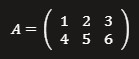

# Matrices
## Caracteristicas
- Las matrices son una especie de vectores anidados
- Pueden ser cuadradas. Quiere decir que sus dimensiones son iguales
- Sus elementos son numeros enteros

Un ejemplo en python seria este
```bash
import numpy as np
matriz = np.array([
    [1, 2, 3],
    [4, 5, 6]
])
print(matriz)
```



Lo que hace es importar la libreria numpy que se utiliza para poder trabajar la matriz.
En este caso es una matriz de 2 filas y 3 columnas, quiere decir de dimension 2x3